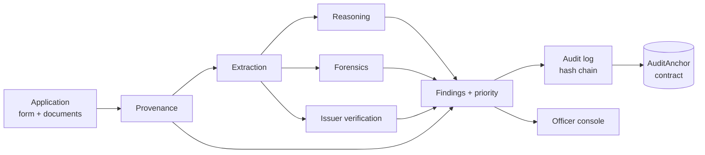

# DocVerf

**Evidence-first AI validation for AICTE Extension of Approval applications.**
*AI extracts, rules decide, officers judge.*


[Demo video](VIDEO_LINK) · [Project document](DOC_LINK) · SIH 2026 · PS 26261 · Team Poseidon01

DocVerf sits between application submission and officer scrutiny. It checks each document, compares
them with one another, and hands the officer a ranked list of findings with the evidence behind each.
**It never approves or rejects an application.**

## The problem

- Officers check every document against the form by hand: slow, repetitive, inconsistent.
- Missing, expired or conflicting documents are often found late, at the visit or hearing stage.
- Confirming a document with its issuing authority is manual and slow.
- Edited dates, pasted signatures and recycled photos are hard to spot by eye, and nothing links a
  problem to the page and value that show it.

## What it does



| Stage | What happens | Code |
|---|---|---|
| **Provenance** | SHA-256 and perceptual hash (photos), duplicate lookup across applications, PDF signature check, QR decoding, metadata | `packages/docverf/provenance` |
| **Extraction** | PDF text layer (PaddleOCR only for pages without text), normalisation of dates, units and IDs, per-field confidence | `packages/docverf/extraction` |
| **Reasoning** | Evidence graph with authority tiers, YAML rules (13 rules plus a required-documents checklist), timeline checks, cross-institution reuse, impact simulator | `packages/docverf/reasoning`, `rules/` |
| **Forensics** | ELA, copy-move, noise and AI-generation signals, reported as *preliminary indicators* only | `packages/docverf/forensics` |
| **Issuer verification** | Looks up the NOC with its issuer through a connector (a mock issuer service here) | `packages/docverf/verification`, `services/mock_issuer` |
| **Priority** | Findings are ranked per application: high-severity findings first | `reasoning/run.py` |
| **Audit** | Every check and finding goes into a hash-chained log; the head hash can be anchored by the `AuditAnchor` contract | `packages/docverf/ledger`, `blockchain/` |

Three rules shape the output. A valid issuer signature means the weaker checks are skipped. Missing
data is never reported as a conflict; a check can agree, conflict, or have too little evidence.
Every finding names its documents, values and the rule that fired.

Cross-institution reuse: a land parcel (survey number, plus village and district when both sides
state them) or a trust registration that an earlier application already claims under a different
institute is flagged as "reused across institutions", with links to the other applications.

## Screens

| Review queue | Application workspace |
|---|---|
|  |  |
| **Network** | **Institute portal (live submission)** |
|  |  |

- **Queue** `/officer`: applications ordered by risk.
- **Workspace** `/officer/applications/<id>`: documents, a PDF or image viewer with evidence boxes,
  findings with "Also claimed by" links, confirm/dismiss actions, and the decision form.
- **Network** `/network`: land parcels, trust registrations, photos and documents shared by more
  than one institute, drawn as a node-link graph.
- **Portal** `/portal`: an institute uploads its documents; the API saves them as a new application,
  runs the pipeline and returns a result card linking to the officer console.
- **Digital twin** `/digital-twin` is a concept preview, not live data.

## Results

Measured on the 20 **synthetic** applications in `data/synthetic`. The data is generated, and the
defects are planted on purpose and listed in each application's `ground_truth.json`. These numbers
show the pipeline finds what was planted; they say nothing about real AICTE applications.

`python -m scripts.check_integration` on the current output:

| | |
|---|---|
| Planted defects caught | **16 of 18** |
| Findings on the 8 clean applications (app001-008) | **0** (priority 0) |
| Outputs that validate against the data contract | **20 of 20** |
| Unexpected high-severity findings | 0 |
| Time for all 20 applications | about 83 s, summed per-application timings (digital PDFs, no VLM, local mock issuer) |

| Caught | Planted defects |
|---|---|
| app009-app017 | land-area mismatch, mortgaged land, owner mismatch, name mismatch, expired NOC, NOC dated before the trust existed, bad reference format, missing documents, duplicate lab photo |
| app018 | a signed NOC edited after signing |
| app020 | area mismatch, owner mismatch, issuer timeout |

**Missed (both on app019, a degraded scan):** the issuer-mismatch defect, because OCR misreads the
reference number, and the pasted signature, because there is no signature-region detector yet.

## Quick start

Python 3.11 with [uv](https://docs.astral.sh/uv/); Node 20+ for the web app and contract tests.
On Windows, use WSL2 for the Python side. If the repo is under `/mnt/c`, run `npm` from Windows
PowerShell: it is much faster than from WSL.

```bash
# 1. environment
uv python install 3.11
uv venv --python 3.11 .venv && source .venv/bin/activate
uv pip install -e . -r requirements/dev.txt -r requirements/extraction.txt \
  -r requirements/provenance.txt -r requirements/forensics.txt -r requirements/reasoning.txt \
  -r requirements/ledger.txt -r requirements/synthetic.txt
uv pip install -r requirements/extraction-paddle.txt     # OCR for scanned pages
cp .env.example .env
# system packages: exiftool and libzbar0; Chrome or Edge is needed to render the synthetic PDFs

# 2. synthetic dataset (writes data/synthetic/app001..app020)
python -m docverf.synthetic --out data/synthetic --n 20

# 3. optional: sign the clean NOCs and tamper app018 (see docs/SIGNING.md)
python scripts/sign_documents.py init-ca

# 4. run the pipeline (mock issuer is started for you; SQLite is enough for the audit log)
DATABASE_URL=sqlite:///data/ledger.db python -m services.worker.pipeline data/synthetic --out data/out/pipeline
python -m services.worker.pipeline data/synthetic --apps app009,app017     # a subset

# 5. check against the planted defects
python -m scripts.check_integration

# 6. start the mock issuer (:8100) and the API (:8000)
bash scripts/demo.sh

# 7. web app, in a second terminal (apps/web)
npm install
npm run build && npm run start      # or: npm run dev
# open http://localhost:3000/officer   (API docs: http://localhost:8000/docs)

# tests
pytest -m "not slow"                # 677 passed
cd blockchain && npm install && npx hardhat test    # 5 passing
```

Notes:
- Signed NOCs only verify where `infra/pki/trust_roots/mock_fire_ca.pem` exists. `init-ca` makes a
  different CA on every machine, and keys and certificates are gitignored. Do not regenerate or edit
  PDFs after signing: it breaks the signatures. Full steps in [`docs/SIGNING.md`](docs/SIGNING.md).
- The VLM extractor is optional. Without a model in Ollama the pipeline runs on the rules
  extractor and records that in `meta.vlm`.
- Anchoring needs `ANCHOR_CONTRACT_ADDRESS` and a reachable node (`BESU_RPC_URL`). Otherwise
  `audit.tx` is `null`; a transaction hash is never made up.
- `python -m docverf.reasoning <folder> --exclude DOC_ID` runs the impact simulator.
- Lint: `ruff check . && ruff format --check .` (never `ruff format` on `docs/`).

## Repository map

| Folder | Contents |
|---|---|
| `packages/docverf/` | Core library: `provenance`, `extraction`, `reasoning`, `forensics`, `verification`, `ledger`, `synthetic`, `schemas` (frozen data contracts), `config.py` |
| `services/` | `api` (FastAPI officer API, submissions, network), `mock_issuer`, `worker` (the pipeline) |
| `apps/web/` | Next.js officer console, institute portal, network page, digital twin |
| `apps/capture-pwa/` | Placeholder for an inspector capture app |
| `blockchain/` | `AuditAnchor.sol`, Hardhat tests and deploy script |
| `rules/` | YAML checklists, rules, graph and timeline checks: editable without code changes |
| `scripts/` | `check_integration.py`, `demo.sh`, `sign_documents.py`, `seed_demo_data.py`, `e2e_smoke.py` |
| `eval/` | Scoring of results against planted defects: `python -m eval data/synthetic` |
| `tests/` | pytest suite |
| `infra/` | Mock CA configuration (`pki/`); Docker Compose is still a placeholder |
| `docs/` | `PRD.md` (what and why), `TRD.md` (how), `SIGNING.md` |

## Limitations and roadmap

**Known limits today**
- **OCR on degraded scans** is weak: it is the reason one planted issuer-mismatch is missed.
- **No signature-region detector.** Layout detection returns one page-wide region, so pasted
  signatures on scans are not caught.
- **Issuers are mocks.** NOC lookup and AICTE records come from `services/mock_issuer`; no real
  authority is called. The pipeline does not yet feed AICTE payment records into the rules.
- **Anchoring** is tested on Hardhat's local network (5 contract tests); it has not been run against
  a Besu node, and the published pipeline outputs are not anchored.
- **Forensics** rarely applies: digital PDFs skip it, and scanned-page tile analysis did not separate
  tampered pages from clean ones, so it is not relied on.
- **Pipeline entry point only.** The per-module CLIs for provenance, forensics, verification and
  ledger are stubs; run `services.worker.pipeline`. There is no Celery worker or Docker Compose
  stack yet, and submissions are processed inside the API request.
- The impact simulator is available from the CLI only; the digital twin is a concept preview.

**Designed, not built:** cross-year comparison of an institute's documents, targeted revalidation
of only what changed, and the inspector capture app.

## Design principles

1. **Prove a document genuine before hunting for manipulation.** Provenance runs first.
2. **Cheap and certain before expensive and uncertain.**
3. **AI extracts, rules decide, humans judge.**
4. **Extract once, reuse everywhere.** Every check reads the same normalised data.
5. **Evidence or it did not happen.** Each finding links documents, regions, values and the rule.
6. **Missing is not a contradiction.** Low-confidence data can never produce a conflict.

## Team

Team Poseidon01, led by Sukrut Mayee. Work was split by module:

| Role | Module |
|---|---|
| Lead | repository, schemas, config, API, pipeline, integration |
| Synthetic data and issuers | `synthetic/`, `services/mock_issuer` |
| Extraction | `extraction/` |
| Provenance, forensics, ledger, blockchain | `provenance/`, `forensics/`, `ledger/`, `blockchain/` |
| Reasoning | `reasoning/` (rule engine, graph checks) |

Contributors: read [`CLAUDE.md`](CLAUDE.md), then `docs/TRD.md` §1 and §5, before changing code.
